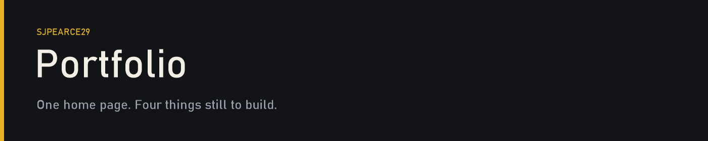

<p align="center">
  
</p>

Open the app and you get one page. A heading, then three lists: the pages still to build, the other repositories, and the languages those use. There is no routing and no deployment yet.

## On this site

| | Page | What it will be | State |
| --- | --- | --- | --- |
| 01 | About | A CV, written in my own words | Not started |
| 02 | Lego wishlist | Sets I want, not a catalogue of everything I own | Not started |
| 03 | Golf | A small app for the game | Not started |
| 04 | A small game | Snake, or a platformer | Not started |

## Other work

| | Repository | What it is | State |
| --- | --- | --- | --- |
| 01 | [spotify-widget](https://github.com/sjpearce29/spotify-widget) | A Spotify control for while I'm working | A title and a sentence |
| 02 | [database-sandbox](https://github.com/sjpearce29/database-sandbox) | A place to try SQL before it becomes part of something else | Empty |
| 03 | [python-sandbox](https://github.com/sjpearce29/python-sandbox) | The same idea, for Python | Empty |
| 04 | [llm-learning](https://github.com/sjpearce29/llm-learning) | A public log of learning language models | Started |

## Languages

| Language | Where it is |
| --- | --- |
| TypeScript | This site. In use. |
| JavaScript | [llm-learning](https://github.com/sjpearce29/llm-learning). In use. |
| SQL | [database-sandbox](https://github.com/sjpearce29/database-sandbox). Not started. |
| Python | [python-sandbox](https://github.com/sjpearce29/python-sandbox). Not started. |

## Stack

<p>
  
  
  
  
</p>

## Run it locally

```bash
npm install
npm run dev
```

Then open [http://localhost:3000](http://localhost:3000).

When a page from the list actually exists, this file should show it. A live URL can go in the repository About box once the site is deployed.
